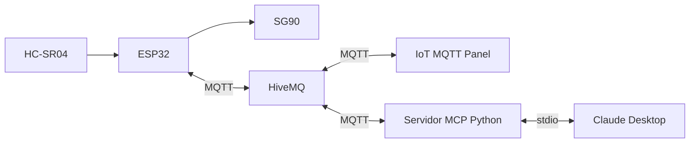
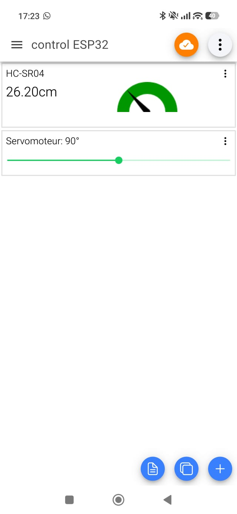

# Práctica MQTT con ESP32

El firmware implementa RF1, RF2 y RF3: mide distancia con un HC-SR04, la publica mediante MQTT y recibe posiciones para un servomotor SG90. Usa `broker.hivemq.com:1883` sin autenticación ni TLS. El broker es público: utiliza solo datos de prueba no sensibles.

## Configuración y conexiones

El proyecto integra un ESP32 con HC-SR04 y SG90, IoT MQTT Panel y un servidor MCP para Claude Desktop. El ESP32, la aplicación móvil y el servidor MCP se comunican a través de HiveMQ; Claude Desktop se comunica con el servidor MCP por stdio.

## Integrantes y responsabilidades

| Integrante | Responsabilidad principal |
| --- | --- |
| Josue Junior Camacho Canaviri | Integración del ESP32: sensor HC-SR04, controlador del SG90, lógica principal y proyecto PlatformIO. |
| Lucas Santiago Ancieta Rodriguez | Integración de WiFi/MQTT, HiveMQ, aplicación móvil y documentación general. |
| Pablo Raya Pommier | Integración del servidor MCP en Python con Claude Desktop y comunicación MQTT. |

- Abre el proyecto en PlatformIO con el entorno `esp32doit-devkit-v1` y Arduino. PubSubClient ya está declarado en `platformio.ini`.
- Completa WiFi en `include/config.local.h`. Si no existe, copia `include/config.example.h` a ese nombre. El archivo local está excluido de Git. El broker, el puerto y el prefijo también se configuran allí.
- Los pines actuales son TRIG GPIO 18, ECHO GPIO 19 y servo GPIO 25; son configurables. Conecta ECHO mediante un divisor de tensión de 5 V a 3,3 V para proteger el ESP32. Alimenta el servo con una fuente adecuada y conecta su tierra a la del ESP32.
- El servo utiliza PWM LEDC de 50 Hz y un mapeo lineal de 0–180° a 500–2400 µs; 90° corresponde a 1450 µs. Los ángulos y pulsos se configuran mediante `SERVO_MIN_DEGREES`, `SERVO_MAX_DEGREES`, `SERVO_MIN_PULSE_US` y `SERVO_MAX_PULSE_US`.

## Tópicos y funcionamiento

Con el prefijo `sis234/grupo3`:

| Tópico | Mensaje | Dirección |
| --- | --- | --- |
| `sis234/grupo3/distancia/cm` | Decimal en centímetros, por ejemplo `25.4` | ESP32 publica |
| `sis234/grupo3/servo/cmd` | Entero en grados, por ejemplo `90` | ESP32 recibe |

Cada 500 ms se intenta una medición; se rechazan lecturas sin eco o fuera de 10–100 cm. Las lecturas válidas se publican mientras haya conexión MQTT, con una cifra decimal, QoS 0 y sin retención. No se acumulan lecturas para reenviarlas después de una desconexión.

El comando debe contener entre uno y tres dígitos ASCII, sin espacios, signos ni decimales, y encontrarse dentro de los límites configurados y de 0–180°. Se rechazan comandos retenidos y configuraciones de pulsos o límites inseguros. El servo no se mueve automáticamente al encender. Como se desconoce su posición inicial, el primer comando aplica directamente la posición solicitada; a partir de entonces avanza hacia cada objetivo en pasos de un grado, con un intervalo mínimo de 20 ms. El mensaje de posición solicitada no confirma el movimiento físico.

El firmware reintenta las conexiones WiFi y MQTT y vuelve a suscribirse tras una desconexión. El monitor serial muestra el estado de conexión, las publicaciones, lecturas inválidas y comandos recibidos. Los comandos de la aplicación y del servidor MCP deben publicarse con `retain` desactivado. El firmware **descarta comandos recibidos como retenidos**, pero **no elimina** mensajes retenidos que ya existan en el broker.

## Prueba

En IoT MQTT Panel configura una conexión MQTT TCP a `broker.hivemq.com`, puerto `1883`, sin usuario ni contraseña, con un identificador de cliente distinto al del ESP32 y al del servidor MCP. Agrega un gauge suscrito a `sis234/grupo3/distancia/cm` y un slider de 0 a 180 que publique valores enteros en `sis234/grupo3/servo/cmd`, con QoS 0 y retain desactivado.

El panel utilizado muestra la distancia del HC-SR04 mediante un gauge y permite solicitar una posición para el servomotor con el slider. En la captura se observa una lectura de 26,20 cm y el slider en 90°:

Para instalar el servidor Python y configurar Claude Desktop mediante stdio, sigue [mcp-server/README.md](mcp-server/README.md) y su ejemplo de configuración con rutas absolutas. Publicar un comando no confirma el movimiento físico.

### Herramientas MCP expuestas

| Herramienta | Parámetros | Propósito |
| --- | --- | --- |
| `consultar_distancia()` | Ninguno | Devuelve la última distancia válida y su antigüedad. Si no hay una lectura reciente (máximo 3 segundos), informa que no está disponible. |
| `mover_servo(angulo)` | `angulo`: entero entre 0 y 180 | Publica el ángulo solicitado por MQTT en el tópico del servomotor; confirma el envío, no el movimiento físico. |

### Requisitos y estado de la demostración

| Requisito | Estado |
| --- | --- |
| RF1: medir distancia | Comprobado con el HC-SR04. |
| RF2: publicar distancia en MQTT | Comprobado. |
| RF3: recibir comandos para el actuador | Movimiento del SG90 comprobado mediante MQTT.fx. |
| RF4: visualización gráfica en la app | Gauge de distancia comprobado en IoT MQTT Panel. |
| RF5: control desde la app | Slider y movimiento del SG90 comprobados. |
| RF6: consulta y control mediante IA y MCP | Comprobado: Claude consultó una distancia de 23,3 cm y controló el servo a 0° y 90° mediante el servidor MCP. |

En una prueba, el monitor serial mostró la conexión WiFi, un primer intento MQTT fallido (`-4`) y una conexión exitosa en el siguiente intento. Después se solicitaron la suscripción al tópico del servo y varias publicaciones de distancia, entre ellas `16.3` y `25.9` cm. Este registro no incluye marcas de tiempo ni una medición física de referencia, por lo que no verifica la frecuencia, la estabilidad ni la exactitud.

En Claude se consultó la distancia mediante `esp32-mqtt` y se obtuvo una lectura de 23,3 cm con una antigüedad de 0,3 segundos. También se enviaron comandos para mover el servo a 0° y 90°. La respuesta de la herramienta confirma el envío por MQTT; el movimiento debe comprobarse visualmente.

### Requisitos no funcionales: valores declarados y resultados

Los siguientes son **objetivos declarados para la demostración**, no resultados comprobados todavía. Reemplaza «Pendiente» por datos **realmente medidos**, o declara explícitamente que no se logró verificar alguno.

| Atributo | Objetivo declarado | Resultado medido | Evidencia / procedimiento |
| --- | --- | --- | --- |
| Estabilidad | ≥ 10 min sin reinicios ni bloqueos | **Cumple** | 10 minutos sin reinicios ni bloqueos |
| Exactitud de distancia | Error absoluto ≤ 3 cm, en rango 10–100 cm | **Cumple** | Error máximo de 1.5 cm. |
| Tiempo de respuesta desde la app | ≤ 1 s hasta que el actuador refleja el comando | **Cumple** |450 ms hasta iniciar movimiento. |
| Frecuencia de publicación | ≥ 2 mensajes de distancia válidos/s | **Cumple** | 60 publicaciones en 30 segundos |
| Reconexión | Automática después de pérdida de WiFi y MQTT | **Cumple** |Reconexión sin intervención en 4 segundos. |

